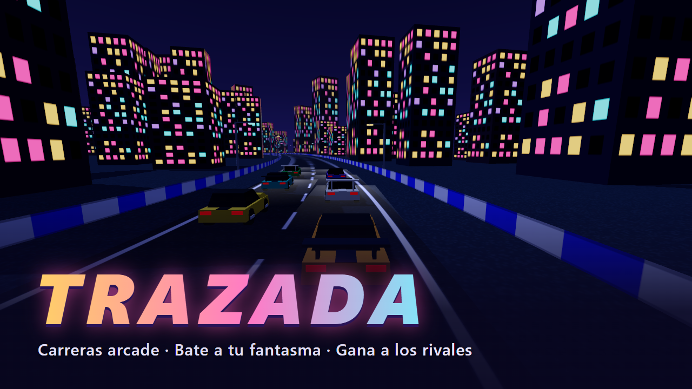

# Trazada

Carreras arcade en 3D low-poly para el navegador. Encuentra la trazada perfecta en cada curva, bate a tu propio
fantasma en la contrarreloj y gana carreras contra cinco rivales.



## Cómo se juega

- **Contrarreloj:** 3 vueltas contra el reloj y contra tu fantasma (tu mejor vuelta en ese circuito). Según tu
  tiempo ganas una medalla de bronce, plata u oro, y las medallas abren los siguientes circuitos.
- **Carrera:** 3 vueltas contra 5 rivales, con dificultad Fácil, Normal o Difícil. Los rivales usan la misma
  física que tú.
- Cada vuelta solo cuenta si pasas por todos los controles del circuito en orden.
- **Circuitos:** Valle Solar (amanecer, ancho y fluido), Cumbre (ocaso, con desnivel y curvas cerradas) y
  Puerto Neón (noche, urbano y estrecho).
- **Coches:** Gorrión (equilibrado), Vencejo (rápido, gira más despacio) y Zorro (ágil, menos velocidad punta).

## Controles

| Acción | Teclado | Mando |
|---|---|---|
| Acelerar | W / ↑ | RT |
| Frenar y marcha atrás | S / ↓ | LT |
| Girar | A D / ← → | Stick izquierdo o cruceta |
| Freno de mano (derrape) | Espacio | A |
| Reaparecer en el último control | R | Y |
| Cambiar de cámara | C | X |
| Pausa | Esc / P | Start |
| Silenciar | M | — |

Los menús se manejan con el teclado (flechas, Tab e Intro) o con el ratón.

## Accesibilidad

- **Reducir movimiento** (en el inicio, en la pausa y en los ajustes) quita la sacudida de cámara, el cambio
  del campo de visión con la velocidad, el humo y las chispas. Viene activada si el sistema operativo tiene
  activada la preferencia de reducir el movimiento.
- Ningún efecto parpadea más de 3 veces por segundo.
- Todo el juego se puede jugar sin sonido: cada aviso sonoro tiene también una señal en pantalla.
- Campo de visión, calidad gráfica, resolución dinámica, volumen, música y ayudas de conducción (dirección,
  frenado y reaparición automática) se pueden ajustar.

## Privacidad

El juego no recoge datos personales ni se conecta a ningún servidor. Solo guarda en el navegador del jugador
(`localStorage`, claves que empiezan por `trazada:`) los ajustes, el progreso, los mejores tiempos y los
fantasmas. Borrar los datos del sitio los elimina.

## Requisitos

Un navegador actual con WebGL activado. Si WebGL no está disponible, el juego lo indica con un mensaje.

## Desarrollo

Necesita Node.js 24 o posterior.

```
npm ci             # instala las dependencias exactas del lockfile
npm run dev        # servidor de desarrollo
npm run build      # comprueba los tipos y genera dist/
npm run preview    # sirve dist/ para probar la versión publicada
npm run test       # tests de la lógica
npm run lint       # análisis estático
```

## Despliegue

`dist/` es un sitio estático con rutas relativas: funciona en cualquier hosting estático y bajo cualquier
subruta.

Con GitHub Pages, el workflow `.github/workflows/deploy.yml` ejecuta lint, tests y build en cada push a `main` y,
si todo pasa, publica `dist/`. Para activarlo, en el repositorio ve a **Settings → Pages** y elige
**Source: GitHub Actions**.

## Licencia

Código, arte procedural, textos y sonido: **Todos los derechos reservados. Titular: Danny Sivinta.**

Las dependencias de terceros y sus licencias están en [docs/LICENSES.md](docs/LICENSES.md). Three.js (licencia
MIT) se incluye en el código publicado junto con su aviso de licencia.
